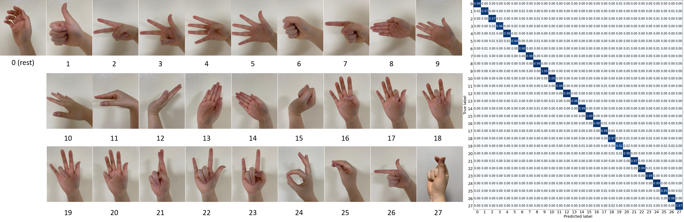

Selected work

# Research projects

From dynamics, actuators, and feedback control to learned policies deployed on physical robots.

## Current focus · Humanoid robotics (2026–present)

### Public KAIROS demonstrations · KIMM (2026)

These examples describe my control-policy contributions to public KIMM demonstrations. The KAIROS robots are team-developed platforms; my role was the locomotion and motion-policy work described below.

#### KAIROS v0.5 · Locomotion policy for both demonstration robots (2026)

I developed the **KAIROS v0.5 locomotion policy** and was responsible for **both KAIROS humanoid robots** presented at KIMM's 50th-anniversary unveiling.

<figure class="project-photo">
  
  <figcaption>Both KAIROS v0.5 humanoids at KIMM's 50th-anniversary demonstration.</figcaption>
</figure>

[KIMM announcement](https://www.kimm.re.kr/eng/sub011001/view/id/1565)

#### KAIROS v0.7 · Locomotion and dancing policies for one forum robot (2026)

I developed **locomotion and dancing policies for one KAIROS humanoid** demonstrated at the **2026 Global Forum on Mechanical Engineering** and was responsible for that robot during the demonstration, rather than both robots featured at the event.

The two videos document separate recordings from the KAIROS v0.7 project.





These demonstrations are part of KIMM's collaborative humanoid program. The responsibilities described above refer specifically to my policy-development and robot-operation contributions.

### Learning-based locomotion and sim-to-real (2026–present)

Developing reinforcement-learning methods for humanoid locomotion with an emphasis on physical deployment. The work connects simulation fidelity, actuator dynamics, feedback interfaces, and robust behavior on hardware.

**Key themes:** locomotion RL · system identification · domain randomization · sim-to-real.

### Coordinated locomotion and manipulation (2026–present)

Exploring how learning-based lower-body control can coordinate with model-based upper-body control, particularly when a humanoid has different actuator characteristics across its joints.

**Key themes:** balance · whole-body coordination · model-based control · precise manipulation.

### Actuator modeling and real-time integration (2026–present)

Characterizing drivetrain behavior and integrating learned policies with low-level control software. These are essential system-level considerations for reliable and reproducible robot performance.

**Key themes:** actuator dynamics · real-time control · hardware debugging · simulation interfaces.

> Other ongoing KIMM research is summarized at a high level; unpublished technical details and internal results are intentionally omitted.

*For earlier projects, the dates below reflect related published research rather than the exact recording dates of the demonstration videos.*

## Motion planning and numerical optimization · ADD (2024–2025)

At ADD, I worked on motion planning and numerical optimization for autonomous systems. The navigation work included NMPC-based path planning for the simultaneous deployment of multiple autonomous vehicles, followed by an MPPI-based driving framework for environments with limited observations. Related conference research addressed QP-based engineering design optimization.

## Wearable robot control · KAIST EXO Lab (2022–2023)

### MPC-based stride-to-stride reference generation



Investigated conservative one-stride reference generation for a bipedal robot subject to modeling errors and external disturbances. Model predictive control generated a trajectory for a lower-level controller to track, with explicit attention to zero-moment-point (ZMP) stability and static transitions between consecutive gait phases. The objective was a feasible stride reference that remained suitable for tracking across phase boundaries.

### Learning human motion with limited robot degrees of freedom



Investigated transferring the character of human walking into a wearable robot with fewer degrees of freedom than its human reference. Adversarial Motion Priors provided a learning-based approach to motion imitation, while robot joint limits, wearer safety, and energy consumption constrained the resulting motion. The central problem was preserving a natural gait without treating imitation as unrestricted pose tracking.

### Robust control for wearable robots



A human wearer can introduce disturbances that are unobservable, nonlinear, and non-periodic. This project studied combining learning-based and model-based control to accommodate that interaction while tracking human-inspired joint references. The control problem also considered the wearer's allowable range of motion and the requirements of a wearable system.

## Soft sensing and human–robot interaction (2021–2024)

### Pneumatic mechanomyography for hand gesture recognition (2023 online / 2024 issue)

Developed a pneumatic mechanomyography (pMMG) approach to extracting high-resolution information from the passive elastic elements near the wrist tendon group. In a study with **10 participants** and **five-fold cross-validation**, the method classified **28 hand gestures with 98.0% accuracy**, compared with **93.1%** for the evaluated eight-channel sEMG system (Delsys, USA). This work aimed to observe tendon behavior rather than rely only on surface electrical muscle activity.

Published in *IEEE Transactions on Industrial Informatics* (2024 issue; first available online in 2023).

### Robust gesture recognition during arm motion



Investigated the practical challenges of gesture recognition when the arm is moving rather than held in a fixed laboratory posture. The work examined sensor placement, training strategies, and classification methods under dynamic arm motion. It also considered detecting out-of-distribution inputs instead of forcing every observation into a known gesture class, with the goal of making the recognition pipeline more robust outside controlled test conditions.

### Soft sensing for gait monitoring (2021–2022)




Conventional IMU and encoder-based gait sensing often requires rigid mounting, which can create alignment problems on wearable systems. We designed an ergonomic soft-sensor system and investigated algorithms for real-time identification of gait phases and walking modes. The emphasis was obtaining usable motion information with less reliance on rigid mounting and on achieving real-time interpretation of sensor signals.


## Selected earlier course project

### Momentum Frame · Learning physics from momentum information



In KAIST CS570, explored a neural surrogate for material-point-method (MPM) simulation using noise-to-noise learning, reconstruction loss, adversarial objectives, and a [CoordConv layer](https://arxiv.org/abs/1807.03247).


