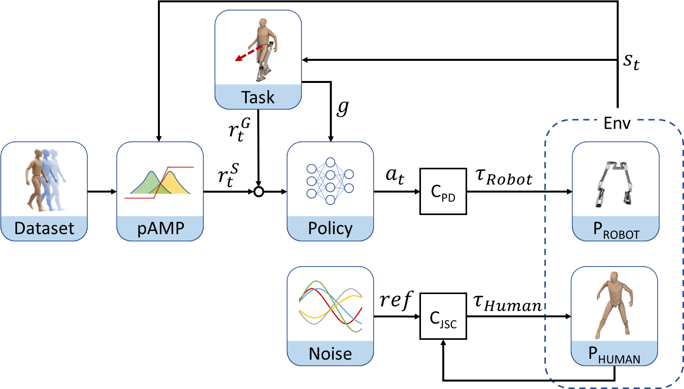
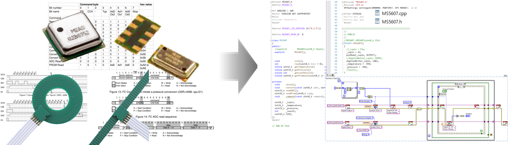
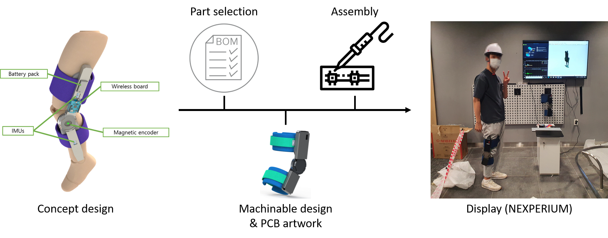
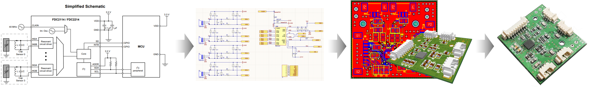

Technical toolkit

# Skills & engineering experience

A system-level approach to robotics: model the physical system, design the controller, build the software interface, then test behavior on real hardware.

## Learning and control

- Reinforcement learning for humanoid locomotion, reference tracking, and motion imitation
- Model-based robot motion control, model predictive control (MPC), and numerical optimization
- Actuator behavior modeling, system identification, sim-to-real transfer, and domain randomization
- Learning and signal processing for wearable sensing and physical human–robot interfaces

## Simulation, programming, and integration

- **Simulation:** Isaac Lab, Isaac Sim, Isaac Gym, MuJoCo
- **Programming:** Python, C, C++
- **Robotics software:** ROS 2, robot control pipelines, simulator-to-hardware integration
- **Development focus:** measurement, debugging, real-time constraints, repeatable experiments



## Real-time, embedded systems, and communication

- STM32, NVIDIA Jetson, and National Instruments platforms
- EtherCAT-based actuator communication and real-time control integration
- RTOS, LabVIEW, SPI, I²C, SSI, UDP, TCP/IP, BLE

## Hardware and mechanical integration

- Mechanical design for machining and additive manufacturing
- Component selection, assembly, and multidisciplinary system debugging
- Integration across mechanisms, sensing, electronics, and controllers

## Electronics

- Circuit schematic design, PCB layout, and datasheet review
- Altium-based PCB workflows
- Embedded sensing and electronics integration

[Research projects →]({{ '/projects' | relative_url }}) · [Publications →]({{ '/publications' | relative_url }})
